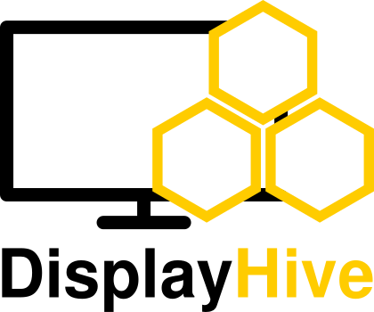

  <picture>
    <source media="(prefers-color-scheme: dark)" srcset="docs/assets/logo-dark.png">
    
  </picture>

<b>Self-hosted digital signage</b> for managing screens, content, and schedules in real time.

  
  
  
  
  
  

  <a href="https://docs.displayhive.org/">Documentation</a> ·
  <a href="https://docs.displayhive.org/user/installation/">Installation</a> ·
  <a href=".github/CONTRIBUTING.md">Contributing</a> ·
  <a href="https://displayhive.org">Website</a>

---

DisplayHive drives networks of displays (kiosks, TVs, info screens) from a single admin
panel. Content is composed on drag-and-drop layouts with named containers, styled
instance-wide with a design, pushed to screens instantly over Socket.IO, and organized
into groups so you can target one display or a hundred at once.

## Features

- **Live content push** — changes in the admin panel appear on screens immediately via Socket.IO, no polling or refresh required.
- **Layouts & containers** — position named containers on a drag-and-drop canvas (with snapping), reuse across screens.
- **Designs** — style a layout with color palettes, gradients, and animated/dynamic backgrounds, independent of its container placement.
- **Content types** — reusable field schemas (text, image, icon, link, table, Pretalx table, date/time, WYSIWYG, ...) that populate containers.
- **Screens & groups** — register devices, assign them to screens, organize screens into groups, and manage assignments from a matrix view.
- **Live preview** — watch exactly what a screen renders from the admin panel, without a physical display.
- **Demo mode** — import ready-made example content packages to explore the admin panel with data already in place.
- **Pretalx integration** — pull conference schedules from a Pretalx instance and render them as content.
- **Screens that look after themselves** — a status dot appears only when something is wrong, screens report to a stored log you can filter in the admin, reconnect with backoff, restart offline from the browser's cache, hide the pointer, keep the display awake and reload daily.
- **Dashboard & search** — see what is on air or about to end at a glance, and jump anywhere with Ctrl+K.
- **Alerting** — Telegram notifications for screens and devices going online or offline, screens leaving or returning to fullscreen, and debug or find mode being switched on or off.
- **Import/export** — back up or migrate any part of an instance (or all of it), by type or individual item, with dependencies auto-included; import can reset the instance or merge into existing data.
- **Rights & groups** — granular per-feature permissions, nested groups, and per-user allow/deny overrides on top of JWT-authenticated, rate-limited login.
- **Single sign-on** — log in with any OpenID Connect provider (Keycloak, Entra ID, Authentik, Google, …); several providers can run side by side.
- **Backups** — scheduled database backups and an automatic backup before every schema migration, plus `flask dh backup`, `backups` and `restore` on the command line (copy them off the machine; see the docs).
- **Aspect ratios & rotation** — every screen has its own aspect ratio and rotation, and layouts carry a variation per ratio, so portrait and ultrawide displays get their own positions.
- **Icon libraries** — install the icon sets you want from the admin; DisplayHive ships none.

## Architecture

Flask + Flask-SocketIO backend (REST/API + realtime hub), a Vue 3 admin panel, and a
framework-free TypeScript screen client, all served by the same process. Deployment is Docker
or a NixOS module. PostgreSQL is the database DisplayHive runs on (`DATABASE_URL` is required);
SQLite works for development and tests only, and only when asked for explicitly — the Docker
image and the NixOS module refuse it.

## Documentation

Everything else — installation, configuration, using the admin panel, and the internals — is in
the docs at **[docs.displayhive.org](https://docs.displayhive.org/)**.

**Getting started**

- [Installation](https://docs.displayhive.org/user/installation/) — Docker, NixOS, and a development setup
- [Getting started](https://docs.displayhive.org/user/getting-started/) — a hands-on walkthrough
- [User guide overview](https://docs.displayhive.org/user/) — how the pieces fit together

**For developers**

- [Developer guide](https://docs.displayhive.org/developer/) — how the backend and frontends fit together
- [Architecture](https://docs.displayhive.org/developer/architecture/) — components, models and the real-time push
- [Project structure](https://docs.displayhive.org/developer/project-structure/) — where things live and where a new file belongs
- [Contributing](https://docs.displayhive.org/developer/contributing/) — setup, tests and conventions

## AI disclaimer

DisplayHive started without any AI usage. As the code evolved, more and more of it was
written with the help of AI coding tools, and this continues. Changes are meant to be reviewed
and understood by the person who commits them, but AI-generated code can contain mistakes
that slip through review. Treat the software accordingly: test it before relying on it, and
if you spot something that looks AI-generated and unreviewed, please
[open an issue](https://github.com/DisplayHive/DisplayHive/issues). The rules for
contributions are in [CONTRIBUTING.md](.github/CONTRIBUTING.md#ai-assisted-contributions).

## Contributing

See [CONTRIBUTING.md](.github/CONTRIBUTING.md) for how to get set up, PR conventions,
and our AI-assisted contributions policy. Please report security
vulnerabilities privately per [SECURITY.md](.github/SECURITY.md) rather than as a
public issue.

## License

[MIT](LICENSE)
